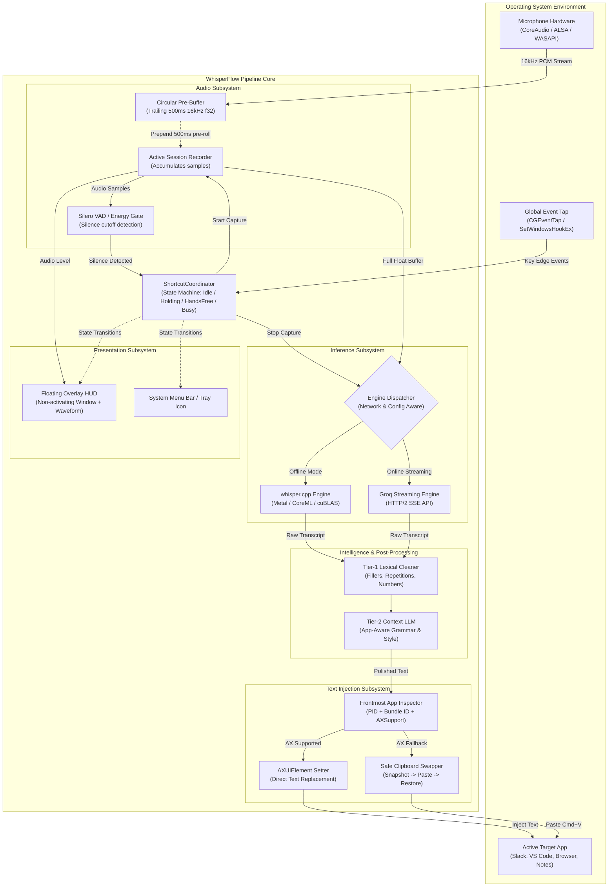
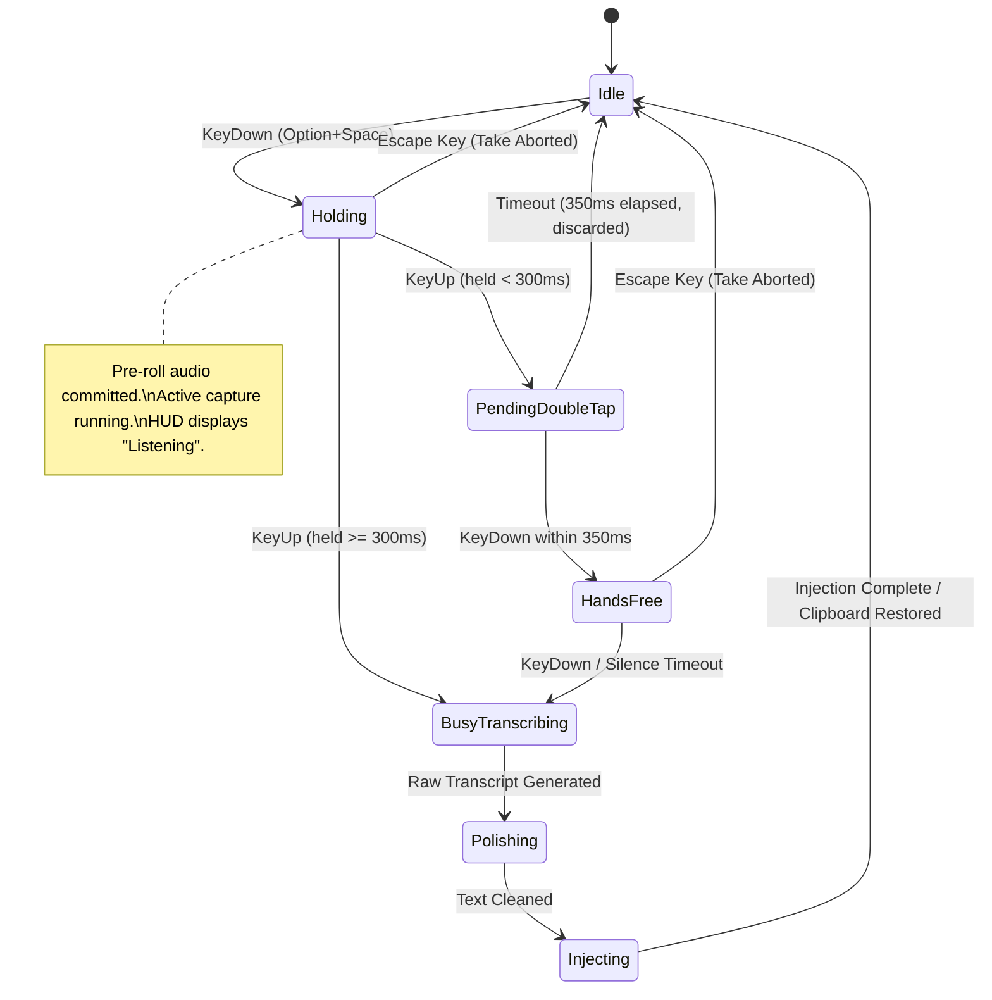

# Architecture: WhisperFlow System Architecture

## 1. System Data Flow Diagram

---

## 2. Global State Machine

The dictation pipeline is orchestrated by a deterministic finite state machine (FSM):

---

## 3. Core Subsystem Boundaries

### 3.1 Audio Subsystem
- **Responsibility**: Continuous non-blocking capture of microphone input. Maintains a circular ring buffer of the trailing 500ms. On trigger, stitches pre-roll and active stream into a contiguous `[f32]` 16kHz mono buffer. Runs VAD silence evaluation.
- **Threading**: Audio callback runs on real-time audio thread (`AudioQueue` / `cpal` worker). Splicing and normalization dispatched off-thread.

### 3.2 Inference Subsystem
- **Responsibility**: Executes speech recognition using local quantized Whisper models or the Groq streaming API.
- **Threading**: Strictly asynchronous; never blocks the UI or main application thread.

### 3.3 Intelligence Subsystem
- **Responsibility**: Transforms raw transcription output into natural, clean, contextually formatted prose.
- **Layers**:
  - `Tier-1`: Synchronous regex-based filler word and punctuation post-processing ($<2\text{ms}$).
  - `Tier-2`: Context-aware prompt engine adjusting output based on the frontmost application.

### 3.4 Injection Subsystem
- **Responsibility**: Delivering the generated text directly to the focused control in the active app without user intervention.
- **Safety**: Guarantees zero clipboard corruption via atomic clipboard snapshot and restoration.

### 3.5 Presentation Subsystem
- **Responsibility**: Lightweight, non-activating floating HUD window displaying live audio level visualizer and pipeline status.
