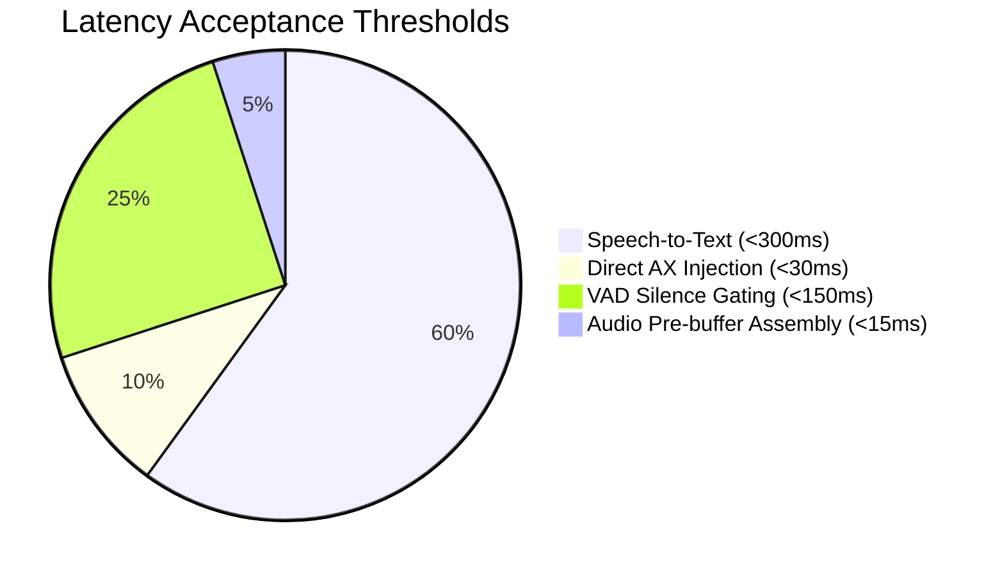

# Assessment: Benchmarks & Quality Gates

## 1. Overview

This document defines the validation criteria, testing methodologies, and automated benchmarks to assess the WhisperFlow pipeline against the Wispr Flow baseline.

---

## 2. Key Performance Indicators (KPIs)



| Metric | Target (Strict) | Target (Acceptable) | Evaluation Method |
| :--- | :--- | :--- | :--- |
| **Cloud Turnaround ($p50$)** | $< 450\text{ ms}$ | $< 600\text{ ms}$ | Automated synthetic audio injection test |
| **Local Turnaround ($p50$)** | $< 700\text{ ms}$ | $< 900\text{ ms}$ | Base.en model on Apple Silicon M-series |
| **Word Error Rate (Clean)** | $\le 4.0\%$ | $\le 5.5\%$ | LibriSpeech test-clean (100 utterances) |
| **Filler Stripping Rate** | $\ge 98.0\%$ | $\ge 95.0\%$ | Disfluency test suite (50 spoken phrases) |
| **Clipboard Corruption Rate** | **$0.0\%$** | **$0.0\%$** | 500 consecutive dictation cycles with active clipboard verification |
| **Idle Memory Footprint** | $< 100\text{ MB}$ | $< 150\text{ MB}$ | 4-hour background resident memory tracking |
| **Idle CPU Utilization** | $< 0.3\%$ | $< 0.8\%$ | macOS `top` / Windows performance counters |

---

## 3. Test Suites

### 3.1 Suite 1: Audio Ring Buffer Verification
- **Test 1.1 (Pre-Roll Continuity)**: Inject a continuous sinusoidal wave. Start recording at $t=500\text{ms}$. Verify that the extracted audio buffer contains the full wave without discontinuities or zero-padding gaps.
- **Test 1.2 (Wrap-Around Correctness)**: Fill ring buffer past $2\times$ capacity. Verify chronological ordering matches original stream index.

### 3.2 Suite 2: Text Injection & Clipboard Safety
- **Test 2.1 (Direct AX Injection)**: Focused in a native `NSTextField` / `UITextView`. Dictate sample text. Verify `NSPasteboard.general.changeCount` remains unchanged and text appears in field.
- **Test 2.2 (Fallback Clipboard Preservation)**: In an application requiring clipboard paste (e.g., Terminal):
  1. Write known secret UUID to clipboard.
  2. Perform dictation injection.
  3. Assert text was pasted.
  4. Wait 60ms; assert clipboard contains the original secret UUID.

### 3.3 Suite 3: Hotkey State Machine Edge Cases
- **Test 3.1 (Micro-Tap Blip)**: Hold hotkey for 45ms and release. Verify that after 350ms, no transcription occurs and no empty string is injected.
- **Test 3.2 (Rapid Double-Tap)**: Two 50ms taps separated by 120ms. Verify coordinator transitions cleanly to `HandsFree` without intermediate trigger.
- **Test 3.3 (Emergency Escape)**: Press `Esc` during audio recording. Verify audio engine stops, buffers are discarded, and HUD vanishes immediately.

---

## 4. Assessment Sign-Off Checklist

```
[ ] 1. Audio Engine
    [ ] 500ms pre-roll verified with zero initial consonant clipping
    [ ] Silero VAD gating false-positive rate < 2% in ambient office noise
    [ ] Clean downsampling to 16kHz mono without audible artifacting

[ ] 2. Inference & Dispatcher
    [ ] Metal whisper.cpp inference RTF <= 0.20 on M1/M2/M3
    [ ] Groq Whisper streaming fallback executes cleanly on network glitch
    [ ] Quantized ggml-base.en-q5_1 model validated for production distribution

[ ] 3. Text Post-Processing & Injection
    [ ] Tier-1 lexical cleaner latency < 2ms
    [ ] Direct AXUIElement injection active on supported apps
    [ ] Zero clipboard clobbering across 500 consecutive test runs

[ ] 4. System & Overlay UX
    [ ] Floating HUD does not steal focus from frontmost active window
    [ ] Dark mode styling and audio level reactive animation smooth at 60fps
```
