# Research: Latency Budget & Timing Analysis

## 1. Overview

Perceived responsiveness in voice dictation apps is governed by the time interval between the user finishing speaking (or releasing the hotkey) and the text appearing in the frontmost application. 

For voice dictation to feel magical and frictionless, total turnaround latency must remain below **$500\text{ms}$** on cloud streaming and **$800\text{ms}$** on local offline inference.

---

## 2. Latency Breakdown Comparison

```mermaid
gantt
    title Latency Budget Comparison (End-to-End Pipeline)
    dateFormat X
    axisFormat %s ms

    section Cloud Streaming (Target: 450ms)
    Key Release / VAD Trigger  : 0, 10
    Audio Buffer Prep & Encode : 10, 35
    Groq Whisper API Turnaround: 35, 335
    L1 Fast Text Cleanup       : 335, 340
    Direct AX Text Insertion   : 340, 370
    Total Turnaround Margin    : 370, 450

    section Local Metal Inference (Target: 750ms)
    Key Release / VAD Trigger  : 0, 10
    Audio Buffer Normalize     : 10, 25
    whisper.cpp Metal (base.en): 25, 625
    L1 Fast Text Cleanup       : 625, 630
    Direct AX Text Insertion   : 630, 660
    Total Turnaround Margin    : 660, 750
```

---

## 3. Stage-by-Stage Budget Allocations

| Stage | Cloud Budget (Target) | Local Budget (Target) | Optimization Strategy |
| :--- | :--- | :--- | :--- |
| **1. Event Tap Trigger** | $< 10\text{ ms}$ | $< 10\text{ ms}$ | Direct OS event tap running on high-priority kernel/thread dispatch queue. |
| **2. Audio Buffer Assembly** | $< 25\text{ ms}$ | $< 15\text{ ms}$ | Pre-allocated circular ring buffer; zero memory allocations during concatenation. |
| **3. Inference Engine** | $< 300\text{ ms}$ | $< 600\text{ ms}$ | **Cloud**: HTTP/2 persistent connection to Groq API (~275ms). **Local**: `ggml-base.en-q5_1` on Apple Silicon Metal or NVIDIA cuBLAS. |
| **4. Post-Processing Cleanup** | $< 5\text{ ms}$ | $< 5\text{ ms}$ | Tier-1 regex/token pass runs entirely in memory without subprocess or LLM overhead. |
| **5. Text Injection** | $< 30\text{ ms}$ | $< 30\text{ ms}$ | Direct `AXUIElementSetValue` bypasses clipboard and OS keyboard queue completely. |
| **Total Pipeline (p50)** | **$\approx 370\text{ ms}$** | **$\approx 660\text{ ms}$** | **Well within the perceptual 500ms / 800ms threshold.** |

---

## 4. Hardware Profiler Integration

WhisperFlow will inspect local hardware capabilities upon boot (using [`HardwareProfiler`](file:///Users/kennethaman/VoiceFlow/VoiceFlow/Sources/Core/HardwareProfiler.swift)) to automatically select the optimal default profile:

| Hardware Tier | Detected Specs | Default Recommended Engine | Target Latency |
| :--- | :--- | :--- | :--- |
| **Tier 1 (High-End)** | Apple Silicon M1-M4 (Unified Memory $\ge 16\text{GB}$) or NVIDIA RTX GPU | Local `small.en` or Cloud Groq | $350\text{ms} - 550\text{ms}$ |
| **Tier 2 (Mid-Range)** | Apple Silicon 8GB or Modern 8+ Core x86 CPU | Local `base.en-q5_1` with Cloud option | $450\text{ms} - 750\text{ms}$ |
| **Tier 3 (Entry/Legacy)** | Intel Mac / Older Dual-Core CPU without Metal/GPU | Cloud Streaming (Groq) default; local `tiny.en` fallback | $400\text{ms}$ (Cloud) / $1200\text{ms}$ (Local) |
